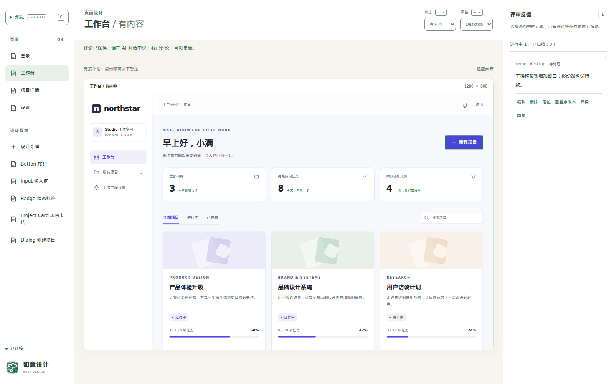
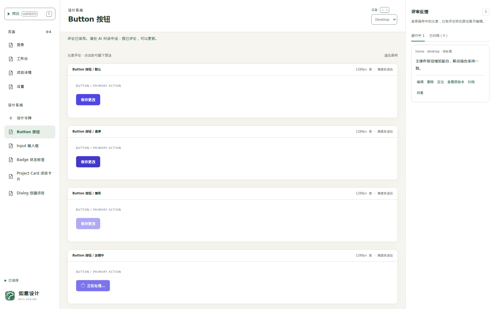

# 如意设计 · Ruyi Design

**English** | [简体中文](README.zh-CN.md)

## Screenshots & description

**Build with your AI coding agent. Review in your browser.**

Ruyi Design is a local workspace for reviewing interactive HTML/CSS/JS prototypes. Connect your coding client through MCP, explore pages across states and devices, and leave comments on the elements you want to change. Ask your agent to make an update, then review the verified revision in the same workspace.



*The bundled Northstar demo, reviewed in Ruyi Design. The workspace UI shown here is in Chinese.*

<details>
<summary>Design system: compare component states</summary>



*Pages, component examples and design tokens share the same repository assets.*

</details>

- **Review the whole flow.** Switch page states and device sizes, interact with the prototype, and compare shared components.
- **Give feedback in context.** Comment on an element, revisit its original version, and keep resolved feedback in the archive.
- **Iterate when you ask.** Your agent processes a round of feedback only after your request. Verified revisions appear automatically; failed validation keeps the previous version available.
- **Keep your assets.** Prototypes remain ordinary HTML, CSS and JavaScript in your repository. The tool connects to your existing coding client and requires no separate model API key.

## Get started

You need **Node.js 24+** and a coding client that supports MCP. Run the following commands from the project whose designs you want to review.

### 1. Install and check

```bash
npm install -D @littlehobby/ruyi-design
npx ruyi-design doctor
```

Doctor defaults to a readable Chinese summary. An available Edge is sufficient; no extra browser installation is needed. For example (other checks also passed):

```text
检查结果：通过
验证浏览器：Microsoft Edge 157.0.4341.42
浏览器来源：系统安装
浏览器启动验证：通过
额外浏览器安装：不需要
```

Use `npx ruyi-design doctor --json` for scripts and `npx ruyi-design doctor --verbose` for the full candidate diagnostics. Existing scripts parsing the old default JSON must add `--json`; `browserInstall` is now optional. See [migration notes](docs/migration-to-ruyi-design.md#doctor-输出格式迁移).

Validation automatically tries installed Chrome, Edge, system Chromium, then an existing Playwright Chromium. If all automatic candidates fail, configure an existing browser or optionally install Chromium in the environment running MCP and check again:

```bash
npx playwright install chromium
npx ruyi-design doctor
```

For a specific browser, use either `RUYI_DESIGN_BROWSER_CHANNEL=chrome` / `msedge` or `RUYI_DESIGN_BROWSER_EXECUTABLE=/absolute/path/to/chromium`. Set only one. See [browser configuration](docs/getting-started.md) for WSL, containers and launch diagnostics.

### 2. Connect your coding client

For Codex, install the project skill:

```bash
npx ruyi-design setup --client codex --project /absolute/path/to/your/project
```

Add this connection to your Codex MCP configuration, replacing the absolute project path:

```toml
[mcp_servers.ruyi_design]
command = "npx"
args = ["--no-install", "ruyi-design", "mcp"]
cwd = "/absolute/path/to/your/project"
tool_timeout_sec = 120
```

Skill setup does not change your MCP configuration. Reconnect the client after adding the connection. Other MCP clients can launch the same `npx --no-install ruyi-design mcp` command from the consumer project; see [MCP integration](docs/mcp.md).

### 3. Open a review

Ask your agent:

> Use Ruyi Design to review this project's `design/` directory. Reuse existing assets, or create an interactive prototype if none exists. Start the review with absolute project and design paths, then give me the review URL.

Open the returned URL. Select a page, state and device; click an element to save a comment. Use **Preview** to interact with the prototype. After adding feedback, tell your agent:

> I have added comments. Please update the design from the saved feedback and publish a verified revision in this same review session.

The workspace updates after validation passes. Confirm the fixes in your browser. Comments saved during an update stay for the next round you request.

For a ready-made example, ask your agent to copy `node_modules/@littlehobby/ruyi-design/examples/starter/design` into a new `design/` directory. The [Northstar starter](examples/starter/README.md) includes four pages, 13 page states, shared components, design tokens, and desktop/mobile layouts.

## Let AI do it

Copy this into your coding client and replace the design brief:

```text
Set up @littlehobby/ruyi-design in this project so I can review an
interactive prototype of [describe your product, page or feature].

1. Install the published npm package and run ruyi-design doctor.
   If no usable browser is available, help me install or configure one
   in the environment running MCP.
2. Inspect this client's MCP configuration and add the ruyi_design
   connection, preserving unrelated settings. For Codex, also install
   the ruyi-design-review project skill. If I need to reconnect the
   client, explain how and stop until the connection is available.
3. Read ruyi-design://guides/review, ruyi-design://schemas/manifest
   and ruyi-design://templates/manifest. Reuse existing design assets;
   otherwise create design/manifest.json and HTML/CSS/JS assets for
   the brief, with shared components and reproducible page states.
4. Start the review with explicit absolute projectRoot and designRoot.
   Return the review URL and stop. Wait for my request before processing
   comments; do not monitor or automatically start another round.
```

You can also request a change directly in chat:

> Make the primary action more prominent on mobile. Keep the current review session and saved comments, validate the change, and publish the revision there.

<details>
<summary>Develop from source</summary>

```bash
npm ci --ignore-scripts
npx playwright install chromium
npm run typecheck
npm run build
npm test
npm run test:browser
```

`npm run preview:starter` opens the bundled consumer demo through MCP. `npm run preview:design` opens this product's own [design prototypes](design/README.md). The two reviews keep separate histories.

Use `npm run pack:local` to build a local tarball in `dist/`. See [Releasing](docs/releasing.md) for npm package preparation and GitHub Actions publishing.

</details>

[Getting started](docs/getting-started.md) · [MCP integration](docs/mcp.md) · [Asset contract](docs/asset-contract.md) · [Local service boundaries](docs/security.md) · [Migration](docs/migration-to-ruyi-design.md)

Published as [@littlehobby/ruyi-design](https://www.npmjs.com/package/@littlehobby/ruyi-design). License: [Apache License 2.0](LICENSE).

Copyright 2026 LittleHobby. Unless otherwise stated, project-owned code and materials are licensed under Apache-2.0. Third-party materials retain their own licenses; see [third-party notices](THIRD_PARTY_NOTICES.md). This license does not grant rights to the Ruyi Design / LittleHobby trademarks, except as provided by the license.

This repository update does not modify previously published npm archives or registry metadata. See the [licensing review](docs/licensing.md) for distribution details.

小爱好出品 · By LittleHobby · 让设计，更合心意。
