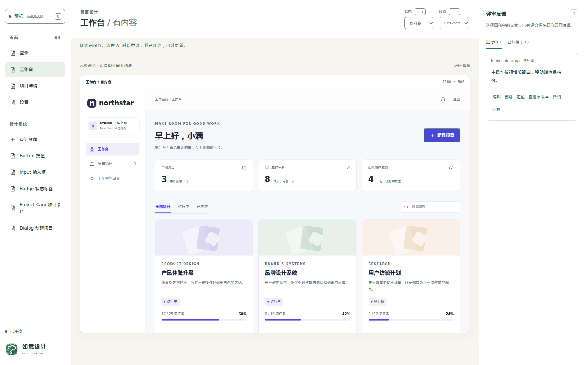
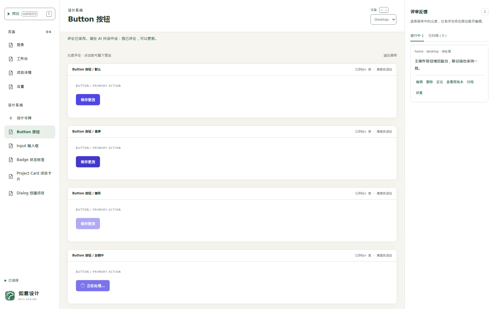

# 如意设计 · Ruyi Design

[English](README.md) | **简体中文**

## 截图与介绍 · Screenshots & description

**让 AI 编写设计稿，在浏览器里体验、评论和确认。**

如意设计是一个本地交互原型评审工作区。通过 MCP 连接现有 AI 编程客户端，即可体验仓库中的 HTML/CSS/JS 设计稿，切换页面状态和设备尺寸，并直接评论需要修改的元素。告诉 AI 可以更新后，在同一工作区查看经过验证的新版本。



*截图展示在如意设计中评审内置 Northstar 示例的过程。*

<details>
<summary>设计系统：比较组件状态</summary>



*页面、组件示例和设计令牌复用同一套仓库资产。*

</details>

- **体验完整流程。** 切换页面状态与设备尺寸，操作交互原型，比较共享组件的适用状态。
- **在元素上留下反馈。** 保存评论、定位目标、查看原版本，并保留已解决反馈的归档记录。
- **由你决定何时更新。** AI 仅在你主动要求后处理一轮。验证通过后工作区自动更新；验证失败时保留旧版。
- **设计资产留在仓库。** 使用普通 HTML、CSS 和 JavaScript，连接现有编程客户端，工具本身不需要额外的模型 API Key。

## 快速开始 · Get started

需要 **Node.js 24+** 和支持 MCP 的编程客户端。以下命令均在需要评审设计稿的项目目录中执行。

### 1. 安装并检查环境

```bash
npm install -D @littlehobby/ruyi-design
npx ruyi-design doctor
```

`doctor` 默认显示清晰的中文摘要。Edge 可用就满足要求，无需额外安装浏览器。例如（其他检查也已通过）：

```text
检查结果：通过
验证浏览器：Microsoft Edge 157.0.4341.42
浏览器来源：系统安装
浏览器启动验证：通过
额外浏览器安装：不需要
```

脚本使用 `npx ruyi-design doctor --json`；排查候选尝试链使用 `npx ruyi-design doctor --verbose`。原先解析默认 JSON 的脚本必须增加 `--json`，`browserInstall` 也改为可选字段，见[迁移说明](docs/migration-to-ruyi-design.md#doctor-输出格式迁移)。

验证会依次尝试已安装的 Chrome、Edge、系统 Chromium 和已有的 Playwright Chromium。如果自动候选全部失败，可以配置现有浏览器，也可以选择在运行 MCP 的环境中安装 Chromium 后再检查：

```bash
npx playwright install chromium
npx ruyi-design doctor
```

也可以指定 `RUYI_DESIGN_BROWSER_CHANNEL=chrome` / `msedge`，或使用 `RUYI_DESIGN_BROWSER_EXECUTABLE=/absolute/path/to/chromium` 指向可执行文件，两者只能设置一个。WSL、容器和启动诊断见[浏览器配置说明](docs/getting-started.md)。

### 2. 连接编程客户端

使用 Codex 时，先安装项目技能：

```bash
npx ruyi-design setup --client codex --project /absolute/path/to/your/project
```

将以下连接加入 Codex 的 MCP 配置，并替换为实际项目的绝对路径：

```toml
[mcp_servers.ruyi_design]
command = "npx"
args = ["--no-install", "ruyi-design", "mcp"]
cwd = "/absolute/path/to/your/project"
tool_timeout_sec = 120
```

技能安装不会修改 MCP 配置。配置完成后重新连接客户端。其他支持 MCP 的客户端也可从使用方项目运行 `npx --no-install ruyi-design mcp`，接入方式见 [MCP 集成说明](docs/mcp.md)。

### 3. 打开评审

告诉 AI：

> 使用如意设计评审本项目的 `design/`。优先复用已有资产；如果还没有设计稿，就先创建可交互原型。使用项目和设计目录的绝对路径启动评审，给我工作区链接。

打开返回的链接，选择页面、状态和设备；点击元素即可保存评论，点击「预览」可直接体验原型。评论完成后，在对话中发送：

> 我已保存评论，请根据这些反馈更新设计稿，并在当前评审会话中发布经过验证的新版本。

验证通过后，工作区会自动更新。你可以在浏览器中确认修复；AI 修改期间新增的评论留到下次明确要求时处理。

想先体验完整示例，可让 AI 将 `node_modules/@littlehobby/ruyi-design/examples/starter/design` 复制到一个新的 `design/` 目录。[Northstar 示例](examples/starter/README.md) 包含四个页面、13 个页面状态、共享组件、设计令牌和桌面/移动布局。

## 交给 AI · Let AI do it

复制以下内容到编程客户端，并替换其中的设计需求：

```text
请在本项目中配置 @littlehobby/ruyi-design，让我可以评审一个
关于［描述你的产品、页面或功能］的可交互原型。

1. 安装已发布的 npm 包，并执行 ruyi-design doctor。
   如果没有可用浏览器，协助我在运行 MCP 的环境中安装或配置。
2. 检查当前客户端的 MCP 配置，添加 ruyi_design 连接，保留其他设置。
   如果使用 Codex，同时安装 ruyi-design-review 项目技能。
   如果需要重新连接客户端，说明具体操作，并等待连接可用后继续。
3. 读取 ruyi-design://guides/review、ruyi-design://schemas/manifest
   和 ruyi-design://templates/manifest。优先复用已有设计资产；
   否则根据需求创建 design/manifest.json 和 HTML/CSS/JS 设计稿，
   使用共享组件，并让页面状态可以直接、稳定地进入。
4. 用明确的绝对 projectRoot 和 designRoot 启动评审。
   返回工作区链接后结束本轮。等我主动要求后再处理评论，
   不持续监听，也不自动开始下一轮。
```

也可以直接在对话中提出修改，不必先保存评论：

> 让移动端的主操作按钮更突出。沿用当前评审会话和已保存评论，验证修改后在这个会话中发布新版本。

<details>
<summary>从源码开发</summary>

```bash
npm ci --ignore-scripts
npx playwright install chromium
npm run typecheck
npm run build
npm test
npm run test:browser
```

`npm run preview:starter` 通过 MCP 打开内置的使用方示例；`npm run preview:design` 打开本产品自身的[设计稿](design/README.md)。两套评审独立保存历史。

运行 `npm run pack:local` 可在 `dist/` 生成本地 tarball。npm 发布准备与 GitHub Actions 发布见[发布说明](docs/releasing.md)。

</details>

[详细入门](docs/getting-started.md) · [MCP 集成](docs/mcp.md) · [资产契约](docs/asset-contract.md) · [本地服务边界](docs/security.md) · [迁移说明](docs/migration-to-ruyi-design.md)

已发布至 npm：[@littlehobby/ruyi-design](https://www.npmjs.com/package/@littlehobby/ruyi-design)。许可证：**UNLICENSED**。

小爱好出品 · By LittleHobby · 让设计，更合心意。
