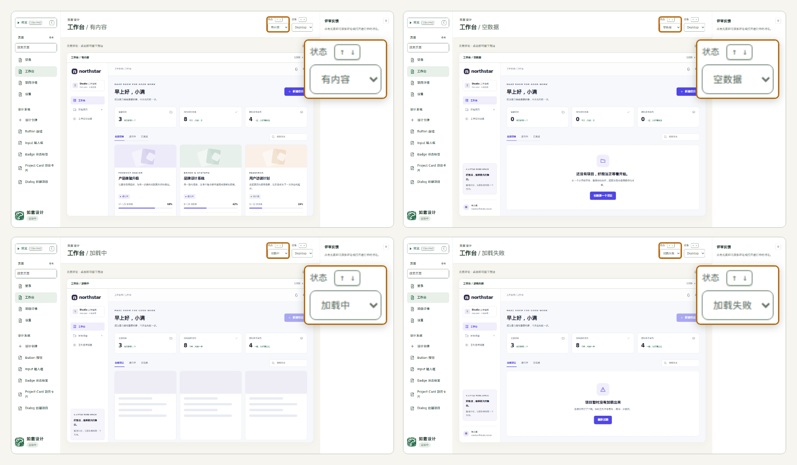
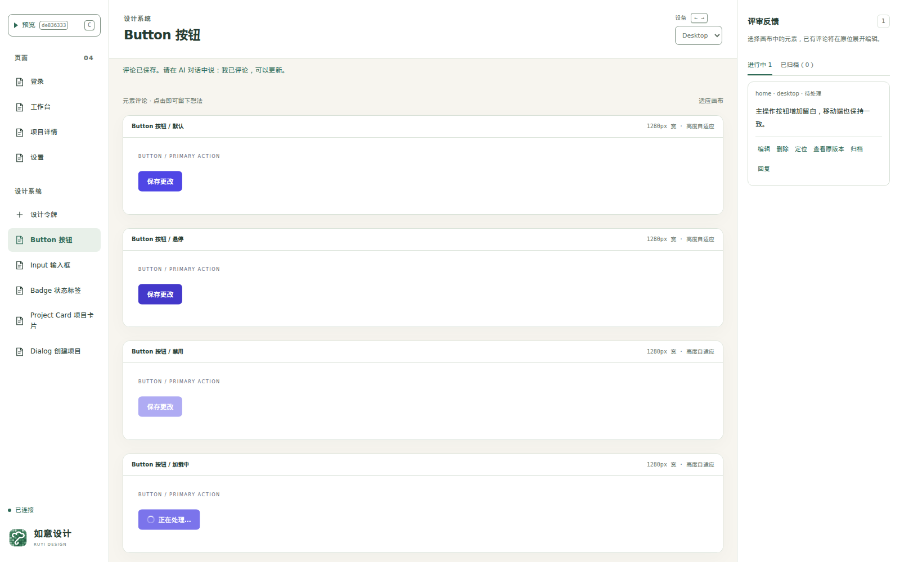
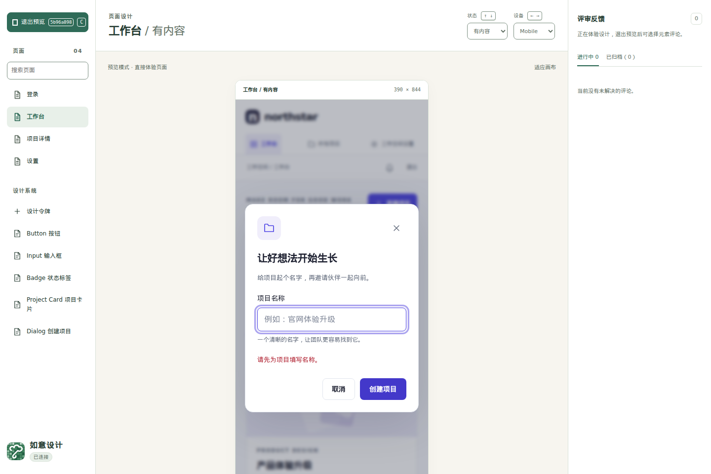
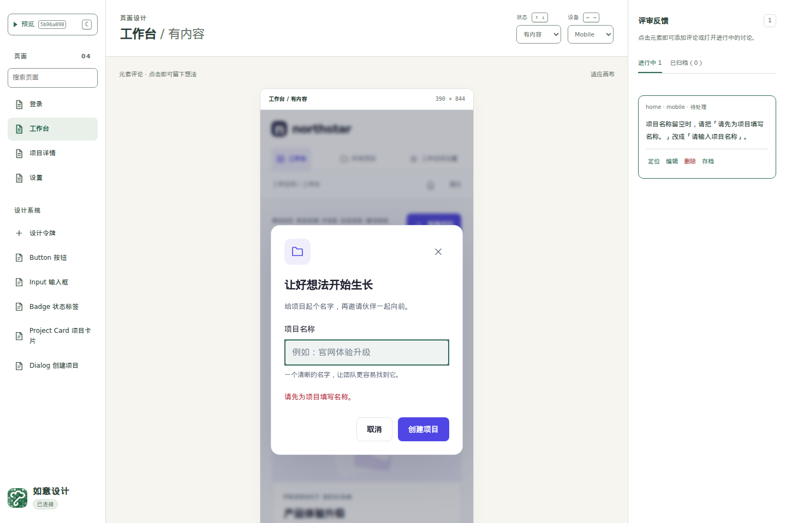
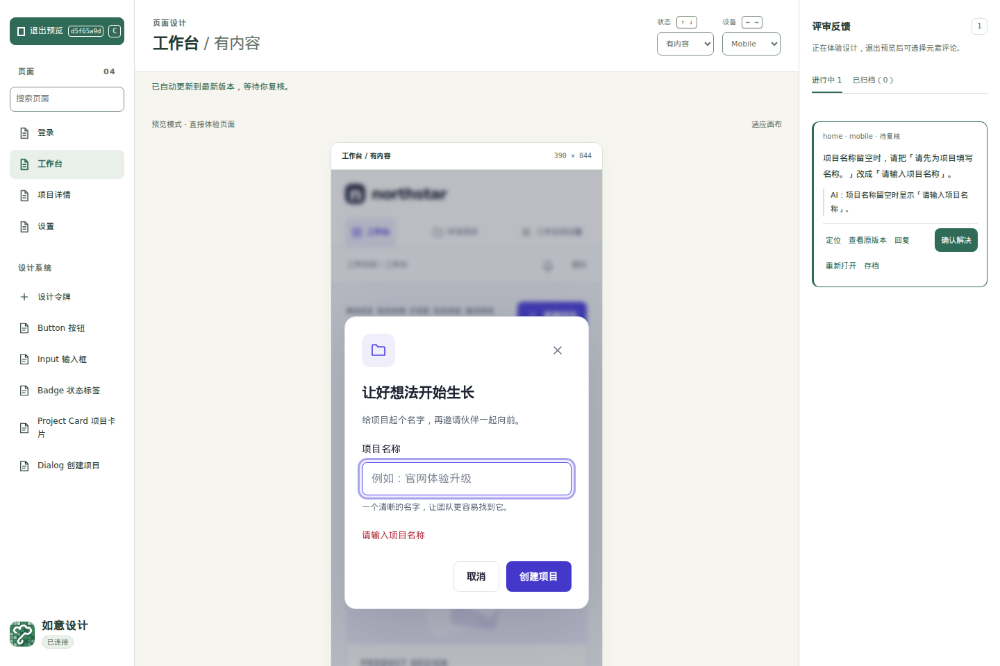

# 我为自己做了一个 AI 原型评审工具，叫如意设计

作为独立开发者，我常常需要先把一个想法做成能点、能试的原型。今天可能是一张产品网页，明天是手机应用，下一次又是游戏里的背包或结算界面。项目形态在变，我还是想沿用同一种工作方式。让手头的 AI 编程智能体快速出稿，我亲手试一遍，设计稿和代码一起进 Git。

我试过的工具各有取舍。有的把设计流程绑在自带的智能体上，有的主要围绕网页搭建，有的设计稿留在平台里，难以跟着项目一起提交和回看。每次换项目，我都希望还能沿用自己的智能体和仓库。

## 我需要的是一个能点着改的工作区

我想打开一个能跑的设计稿，哪里不合适就点哪里，留一句话，等看完这一轮再交给智能体改。出稿和改稿都由我已经在用的智能体负责，我把时间用来判断界面和交互是否合适。

同时，我想把设计约定先定下来。颜色、字号和间距写成设计令牌，按钮、输入框和弹窗做成共享组件。让智能体用这些资产组装页面，后来补一个页面或改一个状态，也有同一套规则可以沿用。这套方式可以用在网页、手机应用和游戏界面的交互原型上。

## 从设计系统出发，把原型点一遍

这就是我做的**如意设计（Ruyi Design）**。它通过 MCP 接入 Codex 等编程客户端，把项目仓库里的 HTML、CSS 和 JavaScript 原型放进本地评审工作区。

在如意设计里，可以先对照同一组件的默认、禁用和加载等状态，再去看它们怎样组成页面。页面也能登记多个可直接打开的状态。以 Northstar 案例项目为例，工作台的有内容、空数据、加载中和加载失败都能单独查看。

*在如意设计工作区切换同一设计稿的四种状态。橙框标出「状态」下拉菜单，每张图右上角放大了当前选项。*

*在设计系统里并排查看组件状态，页面复用同一套组件和设计令牌。*

我也可以让智能体按需求在清单里添加设备尺寸，然后在工作区实时切换查看。做手机应用原型时，可以对照不同屏幕尺寸下的布局。做游戏界面时，也可以定义横屏画布，看看 HUD、背包或结算弹窗摆在一起时是否清楚。这些都是在浏览器里运行的交互原型，设计资产仍然跟着项目仓库走。

## 看完一轮，再让智能体改一轮

继续看 Northstar 案例。我在移动端预览里打开「新建项目」，留空提交，看到「请先为项目填写名称。」我想让提示更直接，就退出预览，点选「项目名称」输入框并保存评论。评论会记住我当时看的页面、状态、设备和元素，回头点「定位」就能找到原处。

*在移动端预览中提交空表单，触发项目名称的错误提示。*

*退出预览后，点选「项目名称」字段，把反馈留在具体元素上。*

等整轮看完，我回到 Codex，说「评论已保存，可以更新设计稿了」。新版验证通过后，工作区会自动更新。我可以从评论定位回对应元素、回看原版本，然后切到交互预览，重新走一遍流程。这一次，再提交空表单，提示就变成了「请输入项目名称」。如果还有想改的地方，就接着留下一轮反馈，直到用起来合适。

*回到同一个工作区，再次提交并复核修改后的提示。*

## 快来试试如意设计

手上正有一个想验证的界面？把这段话发给你正在用的 AI 编程客户端，就可以从自己的项目开始体验如意设计 v0.5.0。

> 请从 npmjs 官方 registry 安装如意设计。先确认当前项目是否使用 npm，再选择安装方式。
>
> - 已有 npm 项目运行 `npm install -D @littlehobby/ruyi-design --registry=https://registry.npmjs.org`，MCP 使用 `npx --no-install ruyi-design mcp`。
> - 其他项目在运行 MCP 的环境中执行 `npm install -g @littlehobby/ruyi-design --registry=https://registry.npmjs.org`，MCP 使用 `ruyi-design mcp`。如果客户端找不到该命令，就使用全局 CLI 可执行文件的绝对路径。
>
> 把 MCP 的工作目录设为当前项目根目录，保留已有配置。参考官方中文 README，用对应的 CLI 执行 `doctor`。如果使用 Codex，再通过该 CLI 执行 `setup --client codex --project <项目绝对路径>` 来安装评审技能。需要我重新连接客户端时，请告诉我怎么操作。连接后确认 `ruyi_design` 工具可用。
>
> [如意设计官方中文 README](https://github.com/teanoon/ruyi-design/blob/main/README.zh-CN.md)

小爱好出品
